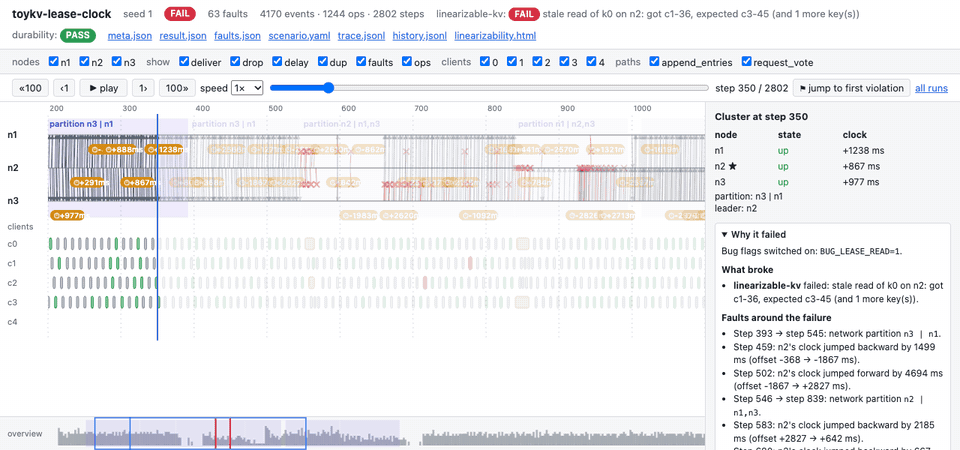
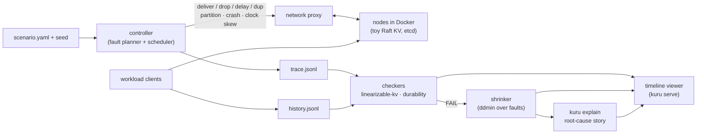

# Kurukshetra

**Kurukshetra finds the bugs your distributed database only shows when the network misbehaves, and explains them in plain English.** It runs a real 3–5 node cluster in Docker, owns every message between the nodes, injects partitions, crashes and clock jumps from a single seed, proves the clients saw wrong answers, then shrinks, replays and visualizes the failure.

**[Live demo](https://yug912.github.io/Kurukshetra-A-Bug-Hunting-Simulator-for-Distributed-Systems/)** (no install: real recorded runs in the timeline viewer) · [How it works](#how-it-works) · [Results](#results) · [Quick start](#quick-start) · MIT licensed



## How it works



Nodes never talk to each other directly: each node's peer addresses point at a proxy listener for that exact sender→receiver pair, so every message is parked until the seeded scheduler decides its fate. The same seed always gives the same fault plan and the same message decisions, so a failure is reproducible from one number.

## Results

Measured on a MacBook Air (Apple silicon, Colima with 4 CPUs) on 2026-11-20, `kuru explore` with 4 runs in parallel. A **FAIL** on a buggy build means Kurukshetra found the bug; the correct builds must **PASS**.

| Target | Bug planted / known | Seeds | Bug found (FAIL) | Correct build under the same faults |
| --- | --- | --- | --- | --- |
| Toy Raft KV | stale reads (`BUG_STALE_READ`) | 20 | **20 / 20** | 20 / 20 PASS (`toykv-correct`) |
| Toy Raft KV | acknowledged writes lost (`BUG_ACK_BEFORE_COMMIT`) | 20 | **20 / 20** | 20 / 20 PASS |
| Toy Raft KV | lease reads on a skewable clock (`BUG_LEASE_READ`) | 30 | **23 / 30** (77%) | 30 / 30 PASS |
| etcd 2.3.8 (real system) | stale reads under partition (Jepsen, 2014) | 200 | **196 / 200** (98%; 3 checker timeouts, 1 PASS) | etcd 3.5.17: **200 / 200 PASS** |

Every FAIL comes with a minimal fault schedule (`kuru shrink`, e.g. 9 faults → 2), a replay with a fidelity score (`kuru replay`), and a plain-English root cause (`kuru explain`): *"n2 was cut off from the majority by the partition at step 546, and its clock jumped back 1688 ms at step 711 … The leader at that time was n3 (since step 670), not n2."*

## Quick start

Needs Go 1.26+, Docker (Docker Desktop, Colima or Linux) and Node 20.

```sh
make build images web                                         # kuru, the toy KV image and the viewer
./bin/kuru explore examples/toykv-stale-read.yaml --runs 20   # → FAIL: stale read of k0 on n1 …
./bin/kuru serve --open                                       # open a FAIL run, press ⚑ jump to first violation
```

Then, on any failing run: `kuru shrink <run-dir>` (minimal faults), `kuru explain <run-dir>` (why it failed), `kuru replay <run-dir>` (same decisions again). Without Docker: `go test ./...` and `kuru explore examples/fake-faults.yaml --runner fake-faults --runs 500`.

## The engine

Kurukshetra runs your cluster (3–5 Docker containers) behind a proxy that owns every node-to-node message. From one seed it decides which messages are delivered, dropped, delayed or duplicated, and when partitions, crashes, pauses and clock skews happen. Everything goes into a trace that can be checked, replayed and visualized.

```sh
kuru run examples/fake-smoke.yaml --seed 42      # one run → runs/fake-smoke/42/
kuru replay runs/fake-smoke/42                    # re-run it, forcing the same decisions
kuru explore examples/fake-smoke.yaml --runs 200  # many seeds in parallel, keep the failures
kuru cleanup                                      # remove anything kuru left behind
```

Same seed, same fault plan, same message decisions. Replay reports a fidelity score because node-internal timers are not controlled. Scenarios with `mode: tcp` proxy raw TCP streams for real-world targets. See [docs/engine.md](docs/engine.md) for the architecture, determinism model, CLI and troubleshooting.

## Finding bugs

- `kuru check <run-dir> [--checkers linearizable-kv,durability]` re-judges a run (exit 0 PASS, 1 FAIL, 2 other).
- `kuru shrink <run-dir>` finds a minimal failing fault schedule → `minimal.json`, `shrink.log`, `<run-dir>-min`.
- `kuru explain <run-dir> [--llm]` writes a plain-English root-cause story (`explain.md`, shown in the viewer); `--llm` rewrites it with Claude or Gemini.
- `make web && kuru serve --open` opens the timeline viewer: run list, player, jump to the first violation, compare a run with its replay or shrink.
- Targets: `targets/toykv` (Raft KV with `BUG_STALE_READ`, `BUG_ACK_BEFORE_COMMIT`, `BUG_LEASE_READ`) and `targets/etcd`
  (etcd 2.3.8's stale reads vs 3.5.17). Build images with `scripts/brain-build-images.sh`.
- Details: [docs/brain.md](docs/brain.md); stage demo: [docs/demo.md](docs/demo.md).

## Make targets

| Target | What it does |
| --- | --- |
| `make build` | Builds `bin/kuru` |
| `make test` | `go test ./...` |
| `make test-integration` | Tests tagged `integration` (need Docker and `docker compose`) |
| `make lint` | golangci-lint if installed, else `go vet` |
| `make images` | Builds `kuru/fake-node` and `kuru/toykv` |
| `make sample` | Regenerates `testdata/sample-run/` |
| `make web` | Builds the timeline UI (`web/timeline`) |
| `make clean` | Removes build outputs and `runs/` |

## Try it without Docker

```sh
go run ./cmd/kuru --help
go test ./...
go run ./cmd/kuru explore examples/fake-faults.yaml --runner fake-faults --runs 500 --parallel 8
```

The `fake-faults` and `fake-sample` runners (in `pkg/fakes`) produce run folders without Docker.

## How it was built

1. **Shared setup** on `main`: the contracts (`pkg/trace`, `pkg/history`, `pkg/scenario`, `pkg/rng`, `pkg/core`), the node protocol ([docs/PROTOCOL.md](docs/PROTOCOL.md)), fakes and a sample run.
2. **Engine** (Person A, `feat/engine`): Docker controller, proxy, scheduler, faults, replay, explorer. Progress: [docs/progress-engine.md](docs/progress-engine.md).
3. **Brain** (Person B, `anushka`): toy Raft KV, workloads, checkers, shrinker, `kuru serve`, timeline viewer, etcd target. Progress: [docs/progress-brain.md](docs/progress-brain.md).

See [CONTRIBUTING.md](CONTRIBUTING.md).

## License

[MIT](LICENSE) © 2026 Anushka Jain and Yug Thakral.
